<div align="center">


# Portal BI

**Indicadores de RH que movem decisões.**

Portal web que reúne relatórios do Power BI num só lugar, com acesso por usuário,
gestão pela própria interface e acompanhamento de uso.


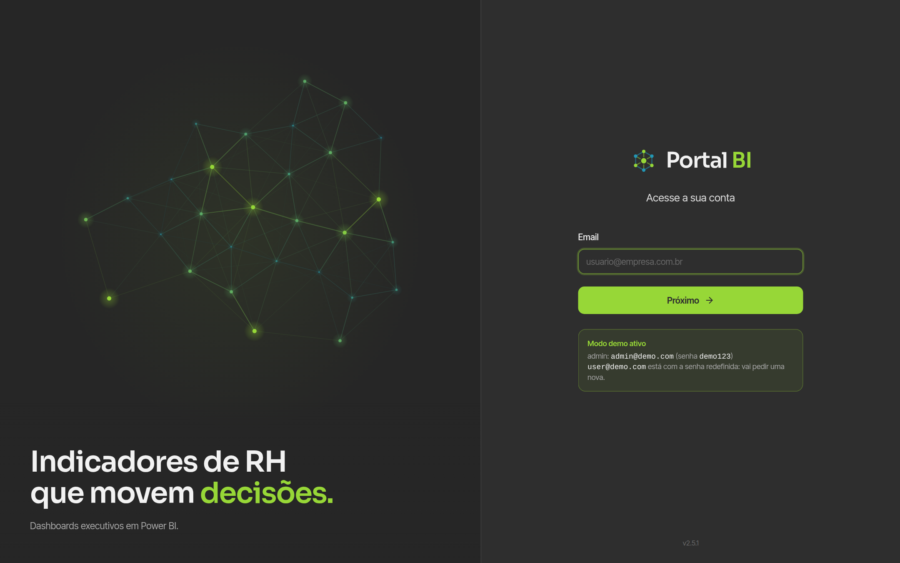

</div>

---

## Sumário

- [O que é](#o-que-é)
- [Destaques](#destaques)
- [Galeria](#galeria)
- [Como funciona](#como-funciona)
- [Segurança](#segurança)
- [Experimente em 1 minuto (modo demo)](#experimente-em-1-minuto-modo-demo)
- [Instalação completa](#instalação-completa)
- [Estrutura do projeto](#estrutura-do-projeto)

---

## O que é

Em vez de distribuir links soltos de relatórios, cada pessoa entra no portal com
email e senha e vê **somente os painéis liberados para ela**. O administrador
decide quem vê o quê, cria e desativa contas e acompanha quem está usando a
plataforma, tudo pela interface, sem mexer no banco.

Os relatórios são publicados no Power BI com **"Publicar na Web"** e embutidos
por iframe. O link de cada relatório fica guardado no banco e só é entregue
depois que o servidor confere a sessão e a permissão do usuário.

---

## Destaques

### 🔐 Login em etapas

O usuário informa o email e clica em **Próximo**; o servidor decide o passo
seguinte:

| Situação | O que aparece |
|---|---|
| Conta normal | Campo de senha |
| Redefinição liberada pelo admin | **Crie sua nova senha** (senha + confirmação) e já entra |
| Email não cadastrado ou conta desativada | Mensagem na própria tela, sem pedir senha |

A redefinição de senha **não depende de email**: o admin libera por 24 h e a
pessoa cria a senha nova direto no login.

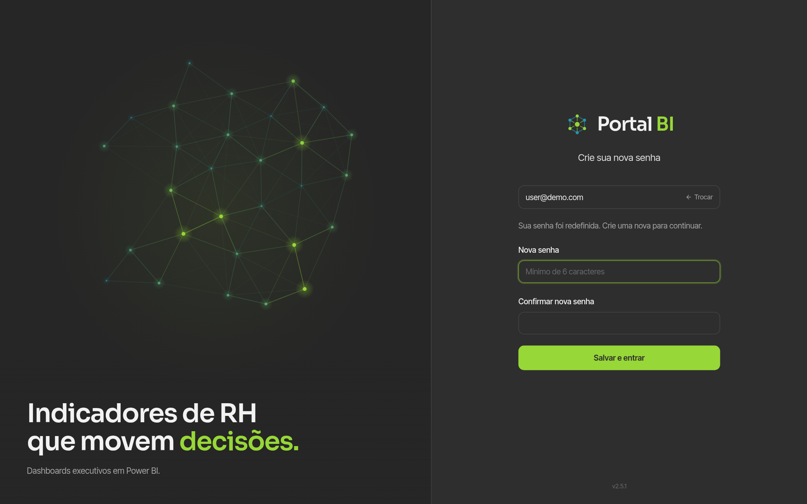

### 🚌 Painéis que abrem rápido (e uma espera divertida)

- **O relatório começa a carregar junto com a página.** O link vem pronto no
  HTML do servidor, sem esperar o JavaScript do portal nem uma chamada extra à API.
- **Os outros painéis carregam em segundo plano** (no computador): trocar de
  painel é instantâneo e preserva filtros e página interna do relatório.
- **Enquanto o Power BI carrega, um ônibus percorre a cidade** e para em pontos
  com nomes de RH ("Rua das Admissões", "Av. do Turnover", "Terminal Headcount"…).
  Quando o relatório termina de desenhar, ele parte e revela o painel. No
  recarregar, o ônibus entra por cima do relatório antes da cidade aparecer.

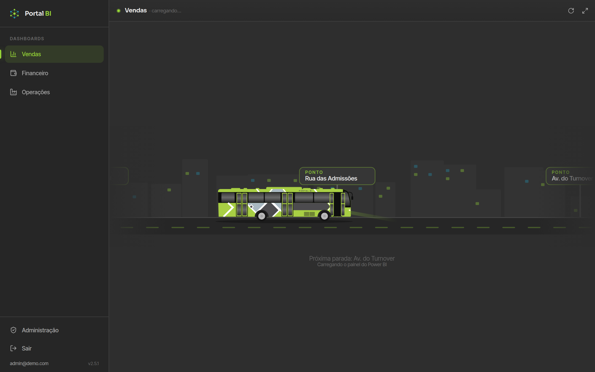

### 👥 Acesso por usuário

- Cada painel é ligado ou desligado por usuário com um interruptor, e salva na hora.
- Papéis `admin` (vê tudo e administra) e `user` (vê só o que foi liberado).
- O admin edita nome e papel, define senha, libera a redefinição pelo login,
  **desativa** ou **exclui** contas.
- Cadastro de painéis: nome, endereço amigável, link do Power BI, ícone, ordem e
  ativo/inativo.

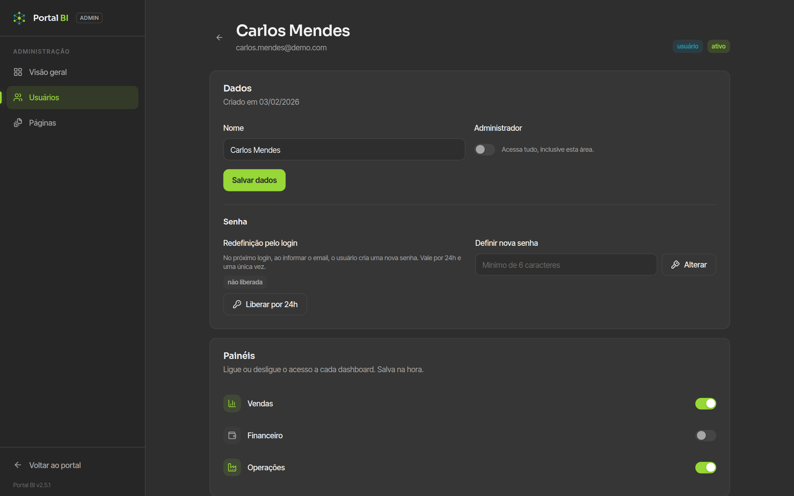

### 📈 Atividade e uso

- Cada abertura de painel é registrada (quem, qual, quando), inclusive ao voltar
  para um painel que ficou aberto.
- Voltar para uma aba do portal que já estava aberta (aba reaparece, janela
  recebe foco ou clique no relatório) também conta, como **retorno**. Último
  acesso, gráfico e atividade recente vêm do mesmo histórico, então sempre batem.
- **Visão geral** com acessos por dia nas últimas 2 semanas, painéis mais abertos
  e as **contas sem acesso há mais de 30 dias**.
- Lista de usuários com **último acesso**, ordenável por nome ou data, e a
  atividade recente de cada pessoa.

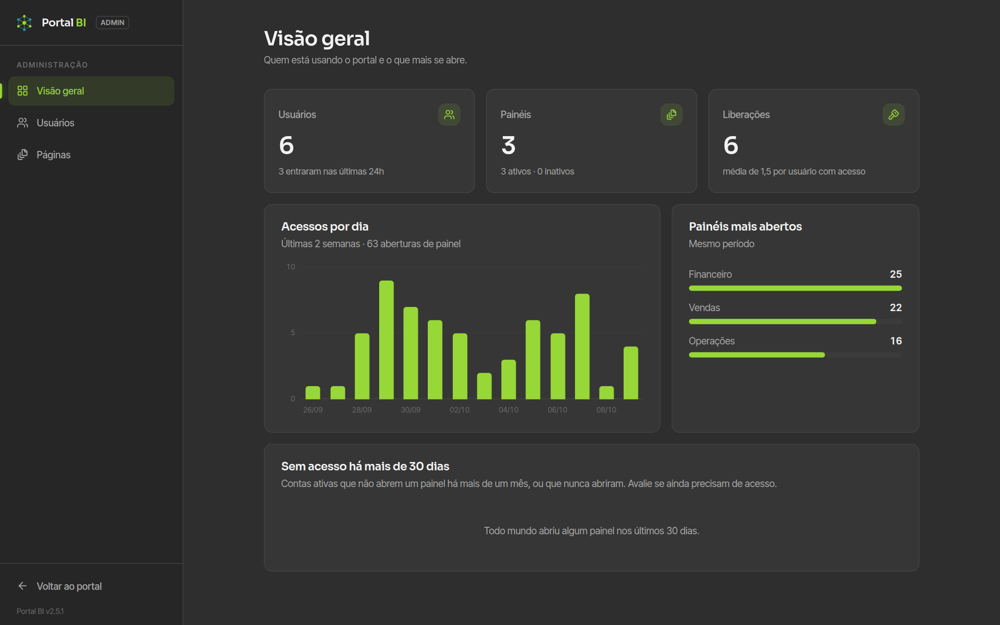

### ✨ Identidade visual

- Tema escuro em grafite (`#2D2D2D`, o mesmo fundo dos relatórios) com acento
  verde-lima `#96D737` e ciano `#2396B4`.
- **Malha interativa** em Canvas 2D no login e na página 404: nós em um campo de
  fluxo, ligações que nascem e somem com a distância, redemoinho ao passar o mouse.
- Animações com curva de mola e respeito a "reduzir movimento".
- **Instalável como app** (PWA), com navegação própria no celular.

---

## Galeria

<table>
  <tr>
    <td width="50%">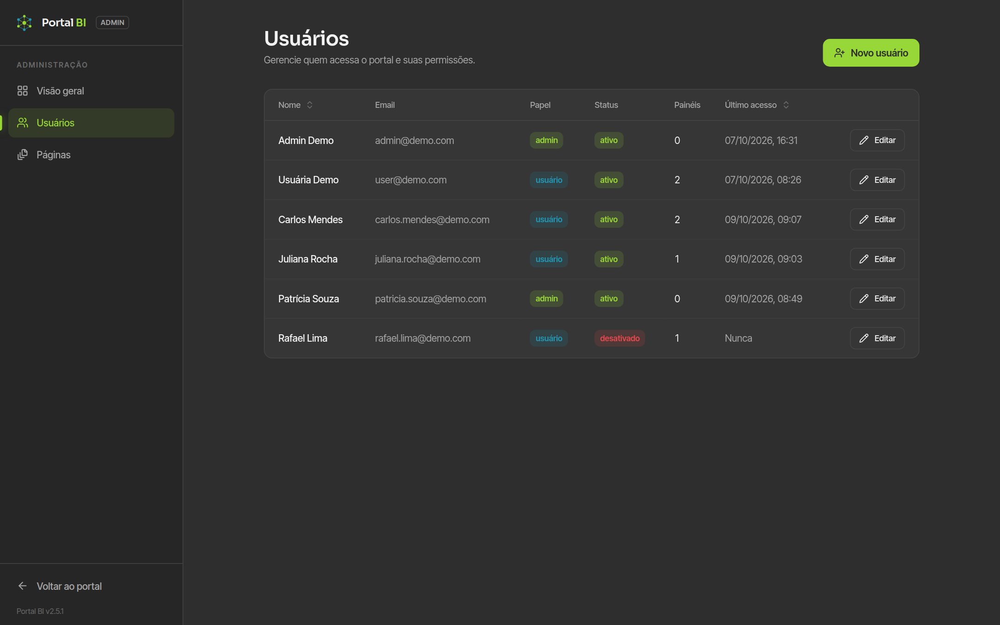<br /><sub>Usuários: último acesso, painéis liberados e status</sub></td>
    <td width="50%">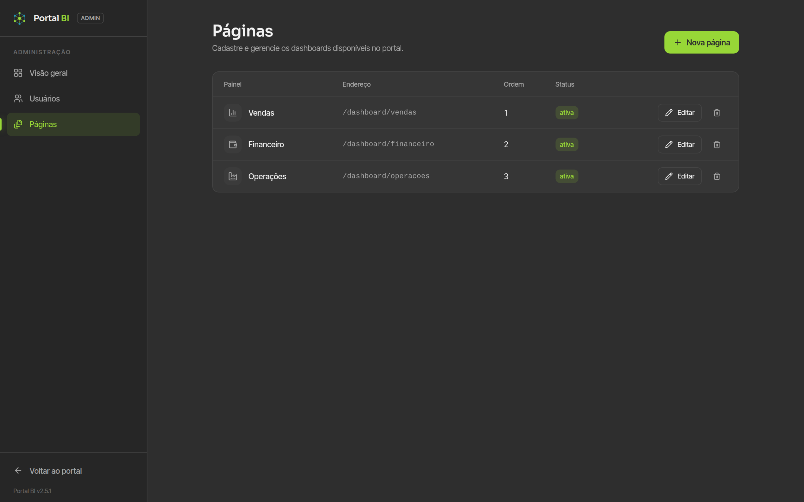<br /><sub>Painéis: cadastro, ordem e ativação</sub></td>
  </tr>
</table>

<table>
  <tr>
    <td align="center">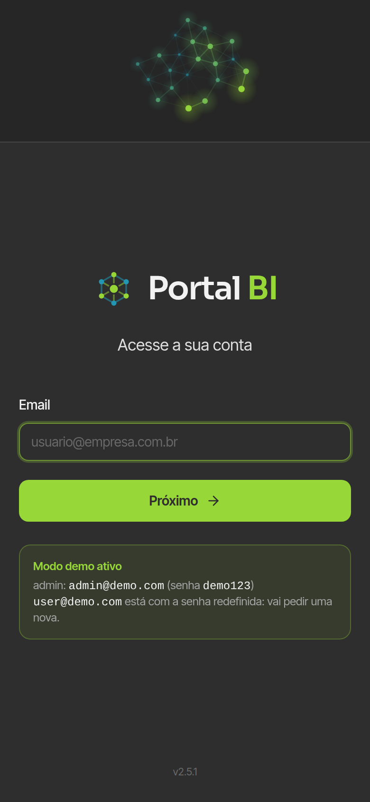<br /><sub>Login</sub></td>
    <td align="center">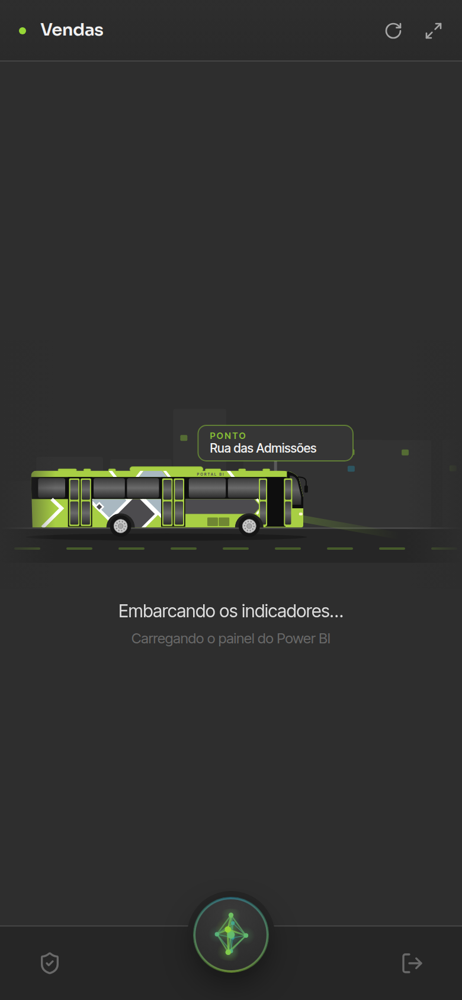<br /><sub>Painel carregando</sub></td>
    <td align="center">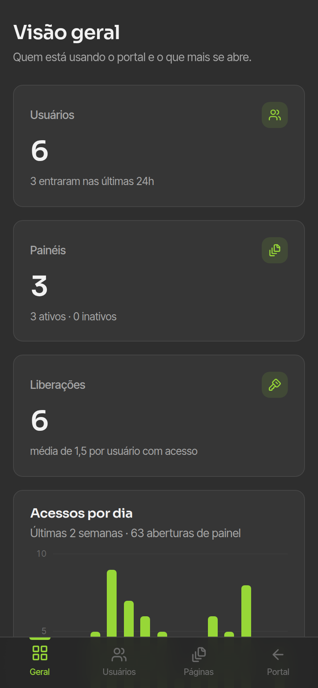<br /><sub>Administração</sub></td>
  </tr>
</table>

<sub>Todas as imagens são do modo demo, com dados fictícios.</sub>

---

## Como funciona

**Stack:** Next.js 14 (App Router, Server Components e Server Actions) ·
TypeScript · Supabase (Postgres, Auth e Row Level Security) · Tailwind CSS com
componentes no estilo shadcn/ui · Vercel (funções na mesma região do banco).
Sem bibliotecas de gráficos: gráficos, malha e ônibus são desenhados à mão
(SVG, CSS e Canvas).

### Abrindo um painel

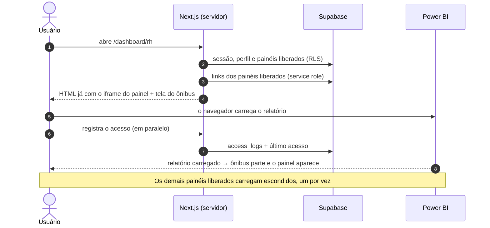

### Dados

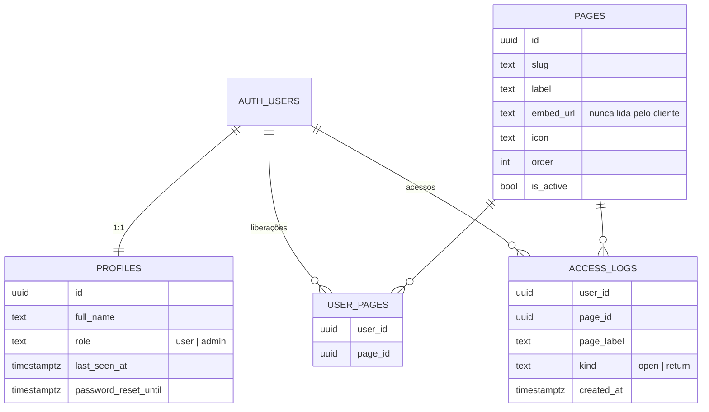

---

## Segurança

| Tabela | Leitura | Escrita |
|---|---|---|
| `pages` | autenticados, **sem** a coluna `embed_url` | apenas admin (server actions) |
| `user_pages` | o próprio usuário / admin | apenas admin |
| `profiles` | o próprio usuário / admin | apenas admin |
| `access_logs` | apenas admin | apenas o servidor |

- `pages.embed_url` tem o `SELECT` revogado para `anon` e `authenticated`
  (privilégio por coluna). O link só sai do servidor depois de validar sessão,
  painel ativo e permissão do usuário.
- O middleware protege todas as rotas; as telas e ações de admin conferem o papel
  no servidor.
- Chaves ficam só em variáveis de ambiente (`.env.local` e Vercel). A
  `SUPABASE_SERVICE_ROLE_KEY` é usada apenas no servidor.

> [!NOTE]
> Decisões conscientes para um portal interno: a primeira etapa do login informa
> se o email existe, e a redefinição liberada pelo admin permite criar a senha só
> com o email enquanto a liberação estiver valendo. Libere por pouco tempo.

---

## Experimente em 1 minuto (modo demo)

Roda sem Supabase, com usuários, painéis e histórico de acessos fictícios em memória.

```bash
echo "NEXT_PUBLIC_DEMO_MODE=true" > .env.local
npm install
npm run dev
```

Acesse `http://localhost:3000`:

| Perfil | Email | Senha |
|---|---|---|
| Admin | `admin@demo.com` | `demo123` |
| Usuário (com redefinição liberada) | `user@demo.com` | cria uma nova no login |

Os painéis de exemplo usam o relatório público de demonstração do Power BI. As
alterações somem ao reiniciar o servidor. **Não use em produção.**

---

## Instalação completa

### 1. Supabase

1. Crie um projeto em [supabase.com](https://supabase.com).
2. Em **SQL Editor → New query**, rode em ordem cada arquivo de
   [`supabase/migrations/`](supabase/migrations/). Em um projeto já em uso, rode
   só as que ainda não foram aplicadas.
3. Em **Authentication → Sign In / Providers**, mantenha **Email** habilitado e,
   se não quiser cadastro aberto, desative *Allow new users to sign up* (o admin
   cria os usuários pelo portal).
4. Em **Authentication → URL Configuration**, defina a **Site URL** com o endereço
   do portal na Vercel.
5. Em **Settings → API**, copie `Project URL`, a chave `anon public` e a chave
   `service_role` (secreta).

**Primeiro admin:** em **Authentication → Users → Add user** (marque *Auto
Confirm User*) e depois, no SQL Editor:

```sql
update public.profiles
set role = 'admin'
where id = (select id from auth.users where email = 'seu-email@empresa.com');
```

### 2. Vercel

1. **Add New → Project** e importe este repositório (a Vercel detecta o Next.js).
2. Em **Environment Variables**:

| Nome | Valor |
|---|---|
| `NEXT_PUBLIC_SUPABASE_URL` | Project URL do Supabase |
| `NEXT_PUBLIC_SUPABASE_ANON_KEY` | chave `anon public` |
| `SUPABASE_SERVICE_ROLE_KEY` | chave `service_role` |

3. **Deploy.** O [`vercel.json`](vercel.json) roda as funções em São Paulo
   (`gru1`); se o seu Supabase estiver em outra região, troque para a mais próxima
   dele.
4. Entre com o admin e cadastre os painéis em **Administração → Páginas**, colando
   o link "Publicar na Web" de cada relatório.

### 3. Rodar localmente com o Supabase real

Crie `.env.local` a partir do [`.env.example`](.env.example) com as três variáveis
e rode `npm install && npm run dev`.

> [!TIP]
> No Windows, edite o `.env.local` pelo VS Code ou Bloco de Notas. O `echo >` do
> PowerShell grava em UTF-16 e o Next.js não lê as variáveis.

---

## Estrutura do projeto

```
src/
├── app/
│   ├── (auth)/login                    # login em etapas + ações públicas
│   ├── (portal)/                       # área do usuário (sidebar / dock)
│   │   └── dashboard/[pageSlug]        # painel (404 e "sem permissão")
│   ├── (admin)/admin/                  # visão geral, usuários, usuário, páginas
│   ├── api/embed-url                   # entrega do link + registro de acesso
│   └── not-found.tsx                   # 404 com a malha
├── components/
│   ├── brand/                          # MeshField (malha), MeshCanvas (orb), MeshMark (logo)
│   ├── dashboard/                      # PanelHost, PowerBIFrame, BusLoader (ônibus)
│   ├── admin/                          # tabelas, formulários, gráficos
│   ├── sidebar/ · shell/ · empty/      # navegação e estados vazios ilustrados
│   └── ui/                             # componentes base (estilo shadcn/ui)
├── lib/
│   ├── supabase/                       # clients: navegador, servidor, service role, middleware
│   ├── auth/                           # sessão e redefinição de senha
│   ├── portal/ · admin/                # painéis liberados, dados da visão geral
│   ├── demo.ts                         # modo demo (dados em memória)
│   └── version.ts                      # versão exibida na interface
└── middleware.ts                       # proteção de rotas
supabase/migrations/                    # 0001 base · 0002 atividade · 0003 redefinição de senha · 0004 tipo de acesso
docs/                                   # contexto do projeto e imagens deste README
```

A versão atual aparece no login e no rodapé da área admin (`src/lib/version.ts`).
